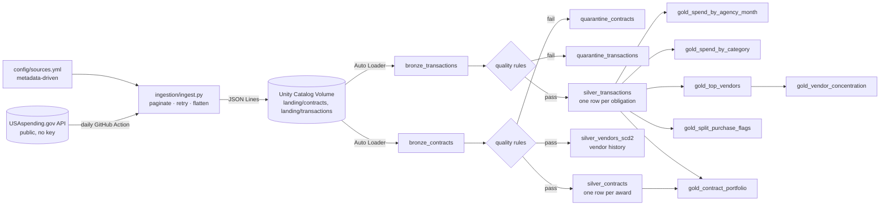

# Federal Procurement Spend Analytics Pipeline

An end-to-end data engineering project on **real U.S. federal procurement data** from [USAspending.gov](https://www.usaspending.gov). It ingests contract awards daily, cleans them through a **Bronze → Silver → Gold** lakehouse on Databricks, and produces procurement analytics: where money goes, which vendors dominate each agency, and which purchases look like they were split to avoid approval thresholds.

## Architecture



## What it answers

| Gold table | Question |
|---|---|
| `gold_spend_by_agency_month` | How much does each agency obligate each month — new awards vs modifications, and how much is taken back? |
| `gold_spend_by_category` | What is the government buying (by PSC product/service code and NAICS industry)? |
| `gold_top_vendors` | Who are each agency's biggest suppliers and what share of spend do they get? |
| `gold_vendor_concentration` | Is an agency's spend competitive or concentrated in a few vendors? (HHI) |
| `gold_split_purchase_flags` | Are there several same-day new awards to one vendor, each just under the approval threshold? |
| `gold_contract_portfolio` | What are the largest contracts by lifetime value, and how much was obligated on them in the loaded period? |

## Design decisions

| Decision | Why |
|---|---|
| **Two grains: contracts and transactions** | An award's amount is its *lifetime* value (a $3.3B contract from 2022 shows up whenever it's modified). Summing it by month would be wrong, so all spend-over-time uses transaction obligations, which carry their own date. Found by profiling the first real data pull. |
| **Negative transactions are valid** | They are de-obligations (money taken back) and are reported separately instead of being filtered out. |
| **Ingestion runs outside Databricks** (GitHub Actions) and lands files in a Volume | Keeps API logic testable in plain Python and works on Databricks Free Edition, where outbound internet is restricted. |
| **Metadata-driven sources** (`config/sources.yml`) | New award types or date strategies are config changes, not code changes. |
| **Day-by-day queries, split further when capped** | The search API returns at most 10,000 rows per query. Each day is queried separately and saved immediately; a day that still hits the cap is re-queried in amount bands (halved until under the cap) and de-duplicated, so no rows are silently lost. Rows from any band that couldn't be fully fetched are marked `_possibly_incomplete`. |
| **Scoped to chosen agencies** (config) | NASA, GSA and EPA keep the volume manageable on free tooling and make the analysis focused; removing one config line pulls every agency. The default backfill (Jul-Sep 2026) covers the federal fiscal year-end, when agencies obligate remaining budget. |
| **Immutable landing files** named by day + run ID | Auto Loader picks up only new files; reruns never overwrite history; any day can be replayed. |
| **Bronze keeps raw strings + `_rescued_data`** | A source schema change can't break ingestion; Silver can always be rebuilt from Bronze. |
| **Quarantine instead of silent drops** | Every failed row lands in `quarantine_contracts` / `quarantine_transactions` with the list of rules it broke. |
| **Auto CDC (SCD1) for awards** | Awards are modified over their life; Silver keeps the latest version, ordered by `last_modified_ts`. |
| **SCD Type 2 for vendors** | Vendor names and locations change; history is kept for point-in-time reporting. |
| **Retry with capped exponential backoff, no retry on 4xx** | Rides out rate limits and outages, but fails fast on a bad request. |
| **Each source-day is isolated, and reruns resume** | If the API keeps failing for one day, it's logged and the run continues; the summary lists failed days and the run exits non-zero. Rerunning the same command skips days already landed. |
| **Split at 5,000 rows, not the 10,000 cap, and pause between pages** | Deep pages were where the public API returned 500s and dropped connections in practice; smaller queries are faster and more reliable. |

## Repo structure

```
config/sources.yml        what to ingest (metadata)
ingestion/                API client + CLI that lands JSON Lines files; calibration + synthetic data generator
pipelines/                Lakeflow declarative pipeline: bronze.py, silver.py, gold.py
tests/                    unit tests: ingestion (mocked API), calibration, synthetic data (planted anomalies are detectable)
docs/setup.sql            one-time catalog / schema / volume setup
.github/workflows/        CI (tests) + daily ingestion schedule
```

## Run it

**1. Try ingestion locally**
```bash
python -m venv .venv && source .venv/bin/activate   # Windows: .venv\Scripts\activate
pip install -r requirements-dev.txt
pytest -q
python -m ingestion.ingest --start 2026-10-01 --end 2026-10-07 --max-pages 2
# -> one file per source per day under data/landing/contracts/ and data/landing/transactions/
```

**2. Set up Databricks** (Free Edition works)
1. Run `docs/setup.sql`.
2. Create a personal access token, then `export DATABRICKS_HOST=... DATABRICKS_TOKEN=...` and run
   `python -m ingestion.ingest --start 2026-07-01 --end 2026-09-30 --target volume` to backfill.
3. Create a pipeline (**Jobs & Pipelines → ETL pipeline**) with the three files in `pipelines/`, target schema `procurement.analytics`. Optional settings: `landing_path`, `split_threshold`.
4. Run it, then build a dashboard on the `gold_*` tables.

**3. Schedule it**: add `DATABRICKS_HOST` and `DATABRICKS_TOKEN` as GitHub repo secrets. `.github/workflows/ingest.yml` lands new data daily; schedule the pipeline in Databricks to run after it.

## Data: real sample + calibrated synthetic extension

| Period | Source | Rows tagged |
|---|---|---|
| Jul 1-3, 2026 | **Real** USAspending.gov data (NASA, GSA, EPA) | `data_source = 'real'` |
| Jul 4 - Sep 30, 2026 | **Synthetic**, calibrated on the real sample | `data_source = 'synthetic'` |

The real sample proves the pipeline works on real government data. To analyze a full fiscal quarter without heavy API use, `ingestion/calibrate.py` learns **aggregate statistics only** from the real files (category mix, amount distributions per category, daily volume, modification and de-obligation rates), and `ingestion/synthetic.py` generates the rest of the quarter from that profile.

Safeguards:
- **Every row is tagged.** `is_synthetic` flows from Bronze to Silver; every Gold table has `data_source`, and the dashboard filters on it. Real and synthetic figures are never blended unknowingly.
- **Synthetic names are always fictional** (e.g. "Department of Space Exploration", "Summit Labs LLC"), so no synthetic record can be mistaken for a real agency or company.
- **Planted anomalies with an answer key** (`data/synthetic_truth/truth.json`) prove the pipeline catches what it should:

| Planted in synthetic data | Caught in |
|---|---|
| Split purchases (2-3 same-day awards just under the threshold) | `gold_split_purchase_flags` |
| Invalid rows (missing agency or amount, end before start, future date) | `quarantine_contracts`, `quarantine_transactions` |
| Re-landed duplicate transactions | `silver_transactions` keeps one copy |
| De-obligations (negative amounts) | `deobligations` in `gold_spend_by_agency_month` |
| September fiscal year-end surge | monthly trend |

```bash
# 1. profile the real sample (in a Databricks notebook, or locally on downloaded files)
python -m ingestion.calibrate --input data/landing --out config/calibration.json
# 2. extend it with tagged synthetic data
python -m ingestion.synthetic --start 2026-07-04 --end 2026-09-30 \
    --calibration config/calibration.json --into-real-landing --target volume
```

## Validation results

Full refresh on 3 days of real data + Jul 4-Sep 30 synthetic data. Every table matches the count computed independently from the generator's answer key:

| Check | Expected | Actual | Proves |
|---|---:|---:|---|
| `bronze_transactions` | 105,987 | 105,987 | Auto Loader read every file exactly once |
| `bronze_contracts` | 104,508 | 104,508 | |
| `quarantine_transactions` | 900 | 900 | every planted bad row caught, none lost |
| `quarantine_contracts` | 984 | 984 | |
| `silver_transactions` | 104,174 | 104,174 | duplicates removed, bad rows excluded |
| `silver_contracts` | 96,048 | 96,048 | each award reduced to its latest version |
| split flags (synthetic) | 41 | 41 | all 39 planted cases found, plus 2 chance coincidences |
| split flags (real) | 4 | 4 | 4 leads in 3 days of real NASA / GSA / EPA data |
| de-obligation rows | 2,044 | 2,044 | negative amounts kept as valid data |

Synthetic September obligations are ~2.6x July, reproducing the fiscal year-end surge.

## Roadmap

- [x] **Phase 1 — Core pipeline**: ingestion client with tests, Bronze/Silver/Gold, quarantine, SCD2 vendors, CI
- [x] **Phase 1.5 — Correct the grain**: added transactions so spend is measured by obligation date, not lifetime award value
- [x] **Phase 2 — Run and validate**: real sample + calibrated synthetic extension, every table validated against an answer key
- [ ] **Phase 3 — Dashboard**: Databricks AI/BI dashboard on the Gold tables (spend trends, top vendors, concentration, flags)
- [ ] **Phase 4 — Observability**: audit table per run (rows in/out/quarantined, duration), data freshness check, failure alerts
- [ ] **Phase 5 — Enrich**: add a second source (e.g. grants, or agency budget data) and join it to procurement spend
- [ ] **Phase 6 — Productionize**: Databricks Asset Bundles for deploy-as-code, pipeline unit tests with sample data

## Data source

U.S. federal spending data from USAspending.gov (U.S. Department of the Treasury), public domain. Split-purchase flags are statistical leads for review, not findings of wrongdoing.
